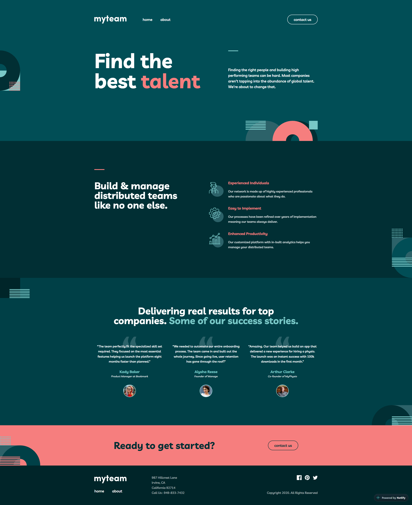

# myteam - Frontend Mentor solution

[](https://github.com/pettik/FrontendMentor--myteam-multi-page-website/actions/workflows/tests.yml)

A responsive three-page company website built for the **myteam multi-page website** challenge. The project includes a Home page, an About page with interactive director cards, and a Contact page with accessible frontend validation.

I built it with a mobile-first approach, semantic HTML, CSS, and vanilla JavaScript, focusing on responsive layouts, consistent shared components, and keyboard interaction.

## Links

| Resource | Link |
| --- | --- |
| Live site | [View the website on Netlify](https://pettik-myteam-multi-page-website.netlify.app/) |
| Source code | [GitHub repository](https://github.com/pettik/FrontendMentor--myteam-multi-page-website) |
| Challenge | [myteam multi-page website on Frontend Mentor](https://www.frontendmentor.io/challenges/myteam-multipage-website-mxlEauvW) |

## Screenshot



*The implemented Home page on desktop.*

## Overview

### Pages and features

- **Home:** hero section, service features, customer testimonials, and a contact call to action.
- **About:** company introduction, six independently expandable director cards, and client logos. Aden Allan's card starts expanded, matching the supplied example state.
- **Contact:** three enquiry topics and a five-field form. Name, Email Address, and Message are required; Company Name and Title are optional.
- **Shared interface:** responsive navigation, footer, hover states, visible keyboard focus, and a skip-to-content link.
- **Mobile navigation:** focus containment, Escape and overlay dismissal, background isolation with `inert`, and scroll locking. The menu state is synchronized when the viewport crosses the navigation breakpoint.

### Challenge requirements

| Requirement | Implementation |
| --- | --- |
| Responsive layouts | Mobile-first CSS with tablet and desktop media queries on all three pages. |
| Interactive states | Hover and keyboard focus styles for navigation, buttons, social links, and form controls. |
| Team-member interactions | Each `+` button toggles its director's biography and social links, updates `aria-expanded`, and becomes a close icon. |
| Empty required fields | Name, Email Address, and Message display **"This field is required"**. Whitespace-only values are treated as empty. |
| Invalid email format | The email field displays **"Please use a valid email address"**, using the browser's email validity state. |

The contact form currently validates in the browser only. It does not send messages or store the entered data. A valid submission displays an explicit validation confirmation and keeps the field values available for editing.

## Built with

- Semantic HTML5, including landmarks, labelled form controls, `blockquote`, and `figcaption`.
- CSS custom properties for the colour palette, typography, and container sizing.
- CSS Grid and Flexbox for page layouts and component alignment.
- Mobile-first media queries at `48em` and `75em` (768px and 1200px with the default browser font size).
- BEM-style class names and separate stylesheets for shared styles, About, and Contact.
- Vanilla JavaScript, DOM events, `matchMedia()`, the `hidden` and `inert` attributes, and ARIA state updates.
- Native email validation through `validity.typeMismatch`, with custom inline error messages.
- Livvic from Google Fonts and the supplied image and SVG assets.
- Git for version control and Netlify for hosting.
- [Vitest](https://vitest.dev/), jsdom, and V8 coverage for automated behaviour tests, with GitHub Actions for continuous integration.

The website runs as static files without a framework or build step. Node.js and npm are needed only for the development test tooling; the HTML, CSS, and browser scripts do not depend on it.

## Project structure

```text
index.html
about.html
contact.html
assets/
  css/
    style.css               # Shared styles and Home page
    about.css               # About page
    contact.css             # Contact page and validation states
  js/
    main.js                 # Navigation and director cards
    contact.js              # Contact form validation
  img/                      # Supplied assets and implementation screenshot
tests/
  navigation.test.js
  directors.test.js
  contact-form.test.js
  helpers/page.js           # Real page fixtures and viewport simulation
  setup.js                  # Isolated DOM cleanup
.github/workflows/tests.yml # Automated checks on GitHub
package.json
package-lock.json
vitest.config.mjs
README.md
```

## Run locally

Clone the repository and serve its root with a local HTTP server. For example, with Python installed:

```sh
git clone https://github.com/pettik/FrontendMentor--myteam-multi-page-website.git
cd FrontendMentor--myteam-multi-page-website
python -m http.server 8000 --bind 127.0.0.1
```

Open [http://127.0.0.1:8000](http://127.0.0.1:8000). VS Code's Live Server extension is another option. An internet connection is needed to load the Google Fonts stylesheet.

## What I learned

### Responsive layouts also affect interaction state

The main responsive lesson was that changing the layout can invalidate JavaScript state. A navigation panel that is hidden and `inert` on mobile needs to become an ordinary, usable navigation bar on desktop.

I used `matchMedia()` to keep the JavaScript breakpoint aligned with the CSS. Crossing that breakpoint closes an open mobile menu, restores scrolling, and moves focus when its previous target would become hidden. This made viewport changes part of the interaction logic rather than just a styling concern.

### Director cards need one source of state

Each director card has a single function that synchronizes its visible content, button label, expanded state, and styling:

```js
toggle.setAttribute("aria-expanded", String(expanded));
card.classList.toggle("is-expanded", expanded);
avatar.hidden = expanded;
role.hidden = expanded;
details.hidden = !expanded;
```

Keeping those updates together avoids a card looking expanded while exposing the wrong state to assistive technology. Native buttons provide keyboard activation, and `hidden` removes collapsed links from the tab order. Each card operates independently, so opening one does not unexpectedly close another.

### Form validation combines browser rules with useful feedback

I kept the browser's email-format check and added the challenge's custom messages around it. Checking trimmed values also catches names and messages containing only spaces, which a simple non-empty-value check would miss.

Validation begins on submission. Errors are connected to their fields with `aria-describedby`, invalid controls receive `aria-invalid`, and focus moves to the first invalid field. Previously invalid fields are checked again as they are edited, while a polite status region communicates the overall result.

A successful validation is separate from delivering a message. The current feedback makes that distinction explicit and preserves the user's input.

### Focus needs a visible and predictable path

I paid attention to more than the colour of a focus outline: opening the menu moves focus inside it, closing it returns focus to the toggle, and the background is made inert while the mobile dialog is open. The shared `:focus-visible` styles and skip link support navigation across all three pages. Menu transitions also respect `prefers-reduced-motion`.

## Challenges and decisions

| Challenge | Decision and trade-off |
| --- | --- |
| Maintaining consistency across three pages | Share CSS variables, navigation styles, footer styles, and interaction code. The HTML remains repeated in the three static files, keeping setup simple while requiring coordinated edits. |
| Matching decorative shapes at different widths | Use the supplied SVGs as positioned CSS backgrounds, with breakpoint-specific placement and cropping. This keeps decorative markup out of the document structure. |
| Keeping director cards usable when content changes | Use a minimum card height and allow content to grow, rather than clipping longer text inside a fixed-height panel. |
| Balancing the reference design with form accessibility | Keep real labels associated with the controls while using the reference's placeholder presentation. Errors remain visible beside the relevant fields and are programmatically associated with them. |

## Testing

The repository includes automated DOM behaviour tests using **Vitest 4**, **jsdom**, and **V8 coverage**. Test dependencies are pinned in `package-lock.json`. The selected versions support the existing Node.js 20.19 environment; Node.js 22.12+ or 24+ can also run them.

Install the development dependencies and run the suite from the repository root:

```sh
npm ci
npm test
```

| Command | Purpose |
| --- | --- |
| `npm test` | Run all test files once and return a failing exit code if a test fails. |
| `npm run test:watch` | Rerun tests while working on page HTML, JavaScript, and test files. |
| `npm run test:coverage` | Run the suite, enforce coverage thresholds, and generate terminal and HTML reports. |

The HTML coverage report is generated locally at `coverage/index.html`; generated reports and `node_modules` are ignored by Git. Coverage measures the production files in `assets/js/`, with minimum thresholds of 90% for statements, lines, and functions, and 80% for branches.

### What the tests cover

| Test file | Behaviour protected |
| --- | --- |
| `tests/navigation.test.js` | Menu initialization on all three pages, opening and dismissal, background isolation state, scroll restoration, Tab wrapping, Escape, and focus transfer across the 768px breakpoint. |
| `tests/directors.test.js` | Correct initial states, every director's biography, independent toggling, ARIA state, preserved focus, and readable content without JavaScript. |
| `tests/contact-form.test.js` | Required and whitespace-only values, invalid and valid email formats, optional fields, inline error associations, first-error focus, live correction, preserved data, and prevention of form submission. |

Tests load the actual HTML pages and import their linked application scripts into a fresh jsdom document for each test. This checks the existing application without introducing test-only branches or changing production scripts. The navigation's `matchMedia` API is simulated because jsdom does not evaluate media queries.

These are DOM integration tests. CSS rendering, native browser Tab movement, enforcement of `inert`, and screen reader announcements still need browser and assistive-technology testing.

### Continuous integration

The [Tests workflow](https://github.com/pettik/FrontendMentor--myteam-multi-page-website/actions/workflows/tests.yml) runs `npm ci` and `npm run test:coverage` on Node.js 24 for pushes and pull requests. It can also be started manually from the repository's Actions tab. The badge at the top of this README reports its status after the workflow is pushed to GitHub.

## Manual verification

The manual review checklist is:

- Navigate all three pages with Tab and Shift+Tab, including the skip link and visible focus states.
- Open the mobile menu, cycle through its controls, dismiss it with Escape or the overlay, and resize across the tablet breakpoint while it is open.
- Open and close every director card using both pointer and keyboard input.
- Submit empty and whitespace-only required fields, an invalid email, and valid values; check error cleanup and preservation of input.
- Compare layouts at narrow mobile, tablet, and desktop widths, including browser zoom and reduced-motion preferences.

## Continued development

- Compare all pages with the original designs in multiple browsers and add mobile, About, and Contact screenshots.
- Extend the DOM test suite with browser end-to-end and visual regression tests, followed by testing with a screen reader.
- If message delivery is added, provide a backend with server-side validation and genuine sending, success, and failure states.
- Introduce shared HTML partials if the site grows, reducing duplication in headers and footers.
- Replace the generic social-platform destinations with real company and director profiles when those are available.

## Useful resources

References for the techniques used in this project:

- [MDN: Using media queries](https://developer.mozilla.org/en-US/docs/Web/CSS/Guides/Media_queries/Using) - responsive CSS, viewport conditions, and media-query monitoring with JavaScript.
- [WAI-ARIA APG: Disclosure pattern](https://www.w3.org/WAI/ARIA/apg/patterns/disclosure/) - the relationship between a disclosure button, `aria-expanded`, and its controlled content.
- [MDN: The `inert` attribute](https://developer.mozilla.org/en-US/docs/Web/HTML/Reference/Global_attributes/inert) - background interaction and focus isolation for the mobile menu.
- [MDN: Constraint validation](https://developer.mozilla.org/en-US/docs/Web/HTML/Guides/Constraint_validation) - using native HTML constraints alongside custom validation feedback.
- [Vitest: Getting started](https://vitest.dev/guide/) - running the test suite, watch mode, and coverage tooling.

## AI collaboration

I used OpenAI Codex to inspect the starter files, implement and refine individual page sections, review interaction state, and run development checks. Working on one page or behaviour at a time made the changes easier to review against the existing vanilla HTML, CSS, and JavaScript.

The collaboration was particularly useful for edge cases such as resizing an open menu and correcting form errors. Direct access to the Figma files and automated browser capture was unavailable in the working environment, so visual comparisons remain a separate review step. The screenshot above is from the implemented site.

## Author and credits

- GitHub: [@pettik](https://github.com/pettik)
- Challenge design, content, and supplied visual assets: [Frontend Mentor](https://www.frontendmentor.io/challenges/myteam-multipage-website-mxlEauvW)
